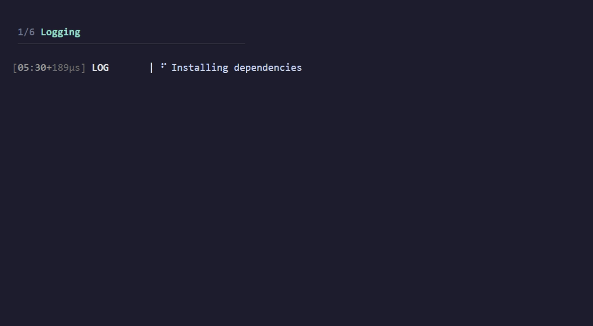
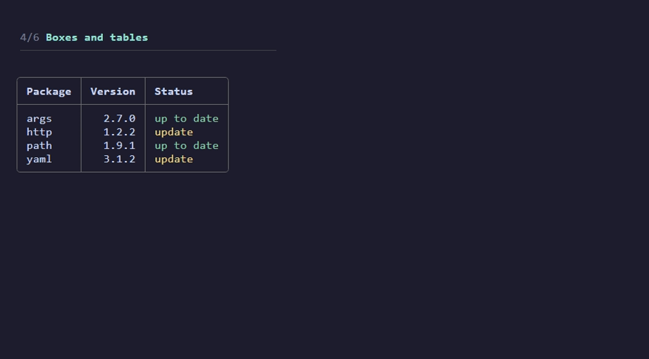
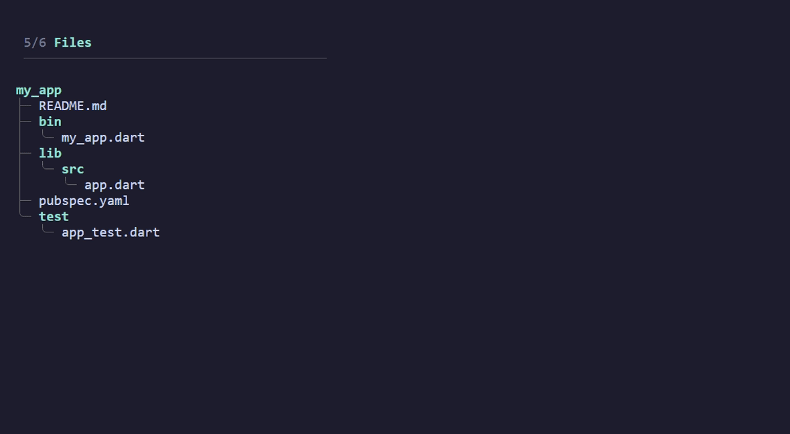

# CMDLINE

An SDK for console development

--- 
> *This demo is just a fraction of what's available because GIFS have to be under 30 seconds and theres a size limit on dart packages*

```powershell
dart run example\main.dart
```

## LOGGING



## STYLING


## PROGRESS


## TABLES



## FILES



## SHELL


