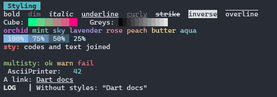
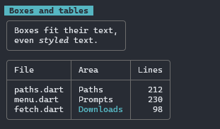
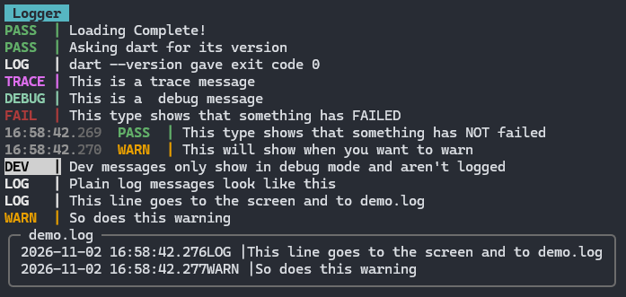
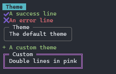
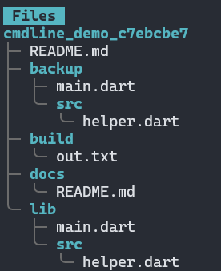
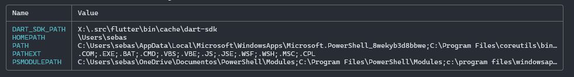
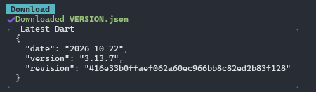

# CMDLINE

An SDK for console development

--- 

## STYLING

Versatile ASCII styling helper methods and constants

## WIDGETS

Basic widgets for CLI applications

## LOGGER

Logging class styled with ASCII that does have a spinner but thats hard to show and idk how to make gifs

## THEME

Styling theme

## FILE-TREES

## ENVIRONMENTAL VARIABLES

## DOWNLOAD HELPERS

